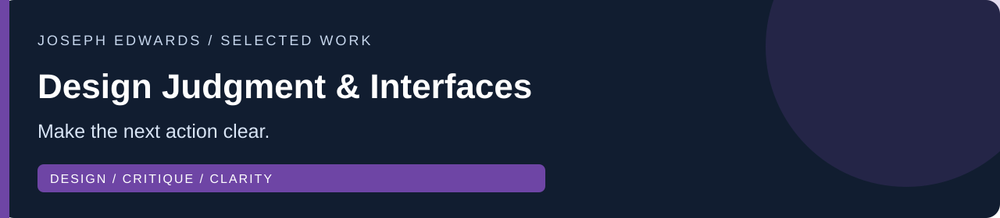
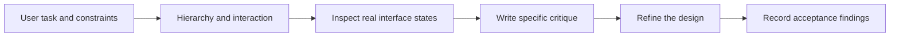

# Joseph Edwards · Design Judgment & Interfaces

I design web and product interfaces around the work a person needs to complete. This portfolio makes my visual decisions, critiques, tradeoffs, and verification scope easy to inspect.

**Relevant work:** Web and interface design, design review, and AI design evaluation. My strongest design specialty is practical web/product interfaces.

[Profile](https://github.com/RawPowered/RawPowered) · [Detailed walkthrough](docs/WALKTHROUGH.md) · [Evidence & scope](docs/EVIDENCE.md) · [Development plan](docs/ROADMAP.md) · [LinkedIn](https://www.linkedin.com/in/josephedwardscto/)

## Start here — a three-minute review

| Evidence | What to inspect | Delivery / evidence scope |
|---|---|---|
| [305UGC web/mobile design](https://github.com/RawPowered/305UGC-Showcase) | Service hierarchy, responsive presentation, and a clear path into project intake. | Public website captured; operational acceptance remains pending. |
| [PowerPortals guided intake](https://github.com/RawPowered/PowerPortals-Showcase#product-tour) | Progressive disclosure, project selection, and reusable service configuration. | Fictional-data tour; private validation. |
| [Flow Fountain operations interface](https://github.com/RawPowered/flow-fountain-for-crms#product-tour) | Separate authoring, execution, and external outcomes in a dense workspace. | Source preview; mocked preview responses are labeled. |

## A closer look

Preview from the existing public portfolio; it illustrates an interface, not a new performance result. [Unpack the decisions and operating approach](docs/WALKTHROUGH.md).

## How the work connects

Conceptual review path, not a captured execution trace. [Inspect the linked evidence and verification limits](docs/EVIDENCE.md).

## Why this path

The role emphasizes design quality, clear critique, refinement, and useful reference examples. The reading path starts with finished interfaces and then exposes the reasoning behind them.

Role alignment informed by the [AI Tutor – Design](https://job-boards.greenhouse.io/xai/jobs/5227940007) posting, reviewed October 25, 2026. This is an independent applicant portfolio; no employer affiliation or endorsement is implied.

## Review with me

Choose one linked case. I can walk through the problem, my responsibilities, the design or integration decision, what was checked, and what still needs acceptance. Public material respects client confidentiality; private source is not implied to be available for redistribution.

The material demonstrates design judgment and interface work. It does not claim foundation-model training, employment as an AI evaluator, published benchmark results, or completed accessibility certification.

**Available for full-time and contract work.** [Connect on LinkedIn](https://www.linkedin.com/in/josephedwardscto/).
