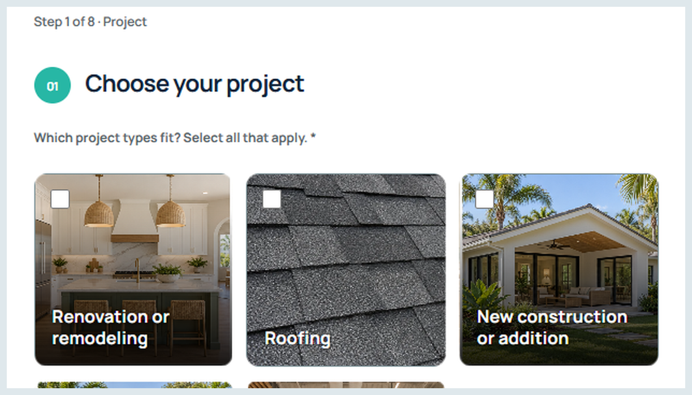

# Critique: make a complex request approachable

**Artifact:** [PowerPortals product tour](https://github.com/RawPowered/PowerPortals-Showcase#product-tour). The capture below is a crop of the existing fictional-data demonstration.

**User task:** identify the appropriate service and start describing a project.

**Successful decision:** named project cards make the first choice recognizable. Staging the intake avoids exposing every service-specific question at once.

**Design tension:** photographic cards can look persuasive while obscuring selection. Persistent text, a distinct selected state, and visible keyboard focus carry the interaction. Images cannot replace those signals.

**Proposed refinement:** review the selected and unselected states side by side, reduce competing visual weight, and put the next action where it remains apparent at narrow widths. This is a proposed refinement, not a claim that a new version shipped.

**Acceptance review:** compare keyboard and touch selection; inspect focus visibility and label contrast; attempt back/continue with an incomplete field; verify that entered answers survive navigation. Record findings before calling the path accessible or accepted.

## Annotation sample

“The service names establish a useful starting hierarchy. The selected state must remain identifiable without relying on the photograph or color alone. Verify focus and selection independently before treating this card layout as complete.”

This is my portfolio critique of the shown interface, not an annotation previously delivered to an AI employer or a measured user-study result.

## Evaluation rubric

| Dimension | Review question | Evidence to retain |
|---|---|---|
| Hierarchy | Is the task and next action clear? | Full viewport and narrow-width capture |
| Typography | Are labels readable and consistently ranked? | Real labels at intended scale |
| Interaction | Can selection, errors, and recovery be understood? | Captured states, not the default screen alone |
| Accessibility | Can keyboard users follow the same path? | Observed focus order and field behavior |
| Restraint | Does each visual element support a task? | Specific removal/refinement rationale |

The rubric is a review framework. No aggregate quality score or usability uplift is asserted.

[Return to overview](../README.md)
